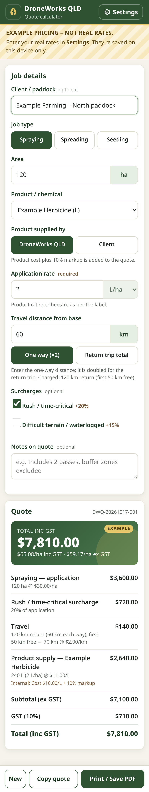

# DroneWorks QLD — Quote Calculator

A simple, mobile-first quote calculator for **DroneWorks QLD** (aerial drone spraying, spreading and seeding — Chinchilla / Western Downs QLD).
Enter the job (type, hectares, product, rate, travel, surcharges) and get an itemised price ex/inc GST, price per hectare, a copy-paste summary and a printable one-page quote.

- Plain HTML/CSS/JS — **no build step, no dependencies, works offline** (just open `index.html`).
- Designed for a phone in the paddock; works on desktop too.



## ⚠️ Pricing and privacy — read this first

This repo is intended to be **public** (free GitHub Pages requires a public repository). So:

- The code ships **only EXAMPLE pricing** (`pricing.example.js`) — round placeholder numbers that are *not* DroneWorks QLD's real rates. While example pricing is in use the app shows an **"Example pricing – not real rates"** banner, and copied/printed quotes are stamped *EXAMPLE PRICING*.
- **Real rates are entered in the app's Settings panel** and saved **only in that browser's `localStorage`** on that device. They are never written to the code, never uploaded, and never committed.
- Use **Settings → Export settings** to save a `.json` backup and **Import settings** to load it on another phone/computer. Keep that file private (don't commit it — `.gitignore` already excludes `*pricing*.json`).
- Note: each browser/device and each address (e.g. the GitHub Pages URL vs. opening the file locally) keeps its own settings, so import your file once on each.
- Clearing browser data / site data will delete saved pricing — keep the export somewhere safe.

## Pricing model (all ex GST until GST is added)

| Line | Calculation |
|---|---|
| Application | hectares × job-type rate ($/ha) |
| Rush / difficult terrain | % of the application fee (optional ticks) |
| Minimum job charge | tops up application + surcharges to the minimum (call-out) charge |
| Travel | charged km = one-way × 2 *or* the return distance as entered; minus free km; × $/km |
| Product supply | only when DroneWorks supplies: rate/ha × ha × unit cost × (1 + markup %) |
| GST | 10% of subtotal |

Printed/copied quotes show the product at the marked-up price per L/kg; the cost and markup are shown on-screen only (marked "Internal").

### Example (placeholder) pricing shipped in the code

| Setting | Example value |
|---|---|
| Spraying / Spreading / Seeding | $30 / $20 / $20 per ha |
| Minimum job charge | $500 |
| Travel | $2/km, first 50 km (return) free |
| Rush / terrain surcharge | 20% / 15% |
| Product markup | 10% |
| Products | Example Herbicide $10/L, Example Insecticide $20/L, Example Fungicide $15/L, Example Fertiliser $1/kg, Example Seed $5/kg |
| GST | 10% · quotes valid 30 days |

## Files

| File | Purpose |
|---|---|
| `index.html` | The app page |
| `styles.css` | Mobile-first styles + print stylesheet (one-page A4 quote) |
| `app.js` | UI: form, breakdown, copy, print, settings dialog |
| `pricing.js` | Pure pricing/validation functions (unit tested) |
| `settings.js` | localStorage save/load, validation, export/import, quote numbers |
| `pricing.example.js` | **Example** placeholder pricing — never put real rates here |
| `business.js` | Public business details & licences printed on quotes (add ABN here if wanted) |
| `tests/` | Node unit tests + optional headless browser check |

## Use it

1. Open `index.html` (or the GitHub Pages URL) on your phone. Tip: "Add to Home Screen" for an app-like icon.
2. Tap **Settings**, enter your real rates and products, tap **Save**. The example banner disappears.
3. Tap **Export settings** and keep the file somewhere private (e.g. your own Google Drive) as a backup.
4. For each job: fill in the details → **Copy quote** (paste into SMS/email) or **Print / Save PDF** (choose "Save as PDF" in the print dialog).
   Quote numbers look like `DWQ-20261017-001` and only advance when a quote is copied or printed. **New** clears the form.

## Publish on GitHub Pages

1. Create a GitHub repository (e.g. `droneworks-quote-calculator`). Free Pages needs it to be **public** — fine, because no real pricing is in the code. (A private repo with Pages needs a paid GitHub plan.)
2. Push this folder:
   ```bash
   git remote add origin https://github.com/<your-username>/droneworks-quote-calculator.git
   git push -u origin main
   ```
3. On GitHub: **Settings → Pages → Build and deployment → Source: Deploy from a branch → Branch: `main` / `(root)` → Save**.
4. After a minute the app is live at `https://<your-username>.github.io/droneworks-quote-calculator/`.
   The page is marked `noindex` so search engines shouldn't list it.

## Tests

```bash
node --test tests/                       # pricing, minimum charge, GST, validation, settings persistence, import/export
# optional headless browser check (needs playwright-core and Chrome/Chromium):
NODE_PATH=/path/to/node_modules CHROME=/usr/bin/google-chrome node tests/browser-check.js
```

## Disclaimer printed on quotes

> This quote is an estimate only, based on the information provided. Final pricing is subject to site assessment, paddock boundaries/area confirmation, weather and product label rates and directions. Chemical and product prices may change with supplier pricing. Prices in AUD.

Edit it in `business.js`.
