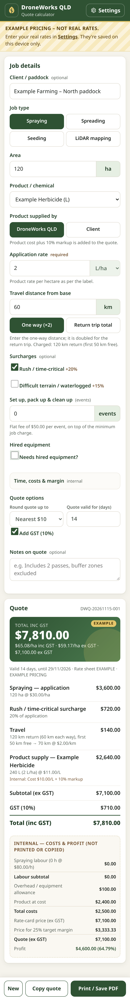

# DroneWorks QLD — Quote Calculator

A simple, mobile-first quote calculator for **DroneWorks QLD** (aerial drone spraying, spreading, seeding and LiDAR mapping — Chinchilla / Western Downs QLD).
Enter the job (type, hectares, product, rate, travel, surcharges, set-up events) and get an itemised price ex/inc GST, price per hectare, a copy-paste summary and a printable one-page quote.

- Plain HTML/CSS/JS — **no build step, no dependencies, works offline** (just open `index.html`).
- Designed for a phone in the paddock; works on desktop too.



## ⚠️ Pricing and privacy — read this first

This repo is intended to be **public** (free GitHub Pages requires a public repository). So:

- The code ships **only EXAMPLE pricing** (`pricing.example.js`) — round placeholder numbers that are *not* DroneWorks QLD's real rates. While example pricing is in use the app shows an **"Example pricing – not real rates"** banner, and copied/printed quotes are stamped *EXAMPLE PRICING*.
- **Real rates are entered in the app's Settings panel** and saved **only in that browser's `localStorage`** on that device. They are never written to the code, never uploaded, and never committed.
- Use **Settings → Export settings** to save a `.json` backup and **Import settings** to load it on another phone/computer. Keep that file private (don't commit it — `.gitignore` already excludes `*pricing*.json`).
- Note: each browser/device and each address (e.g. the GitHub Pages URL vs. opening the file locally) keeps its own settings, so import your file once on each.
- Clearing browser data / site data will delete saved pricing — keep the export somewhere safe.

## What's new in v0.2

- **LiDAR mapping** job type: half day, full day or hourly capture, plus processing hours as its own line. Floors are enforced (a full day is never below the full-day floor; a hired unit is never below the half-day floor; owned kit / an already-covered hire week uses a minimum billable hours rule). Over ~4 hours on site the app suggests a full day.
- **Time breakdown** (planning/admin, travel, on-site, processing/reporting hours × labour rate + extra crew) with a labour subtotal for the chosen job type.
- **Overheads & target margin**: price = costs ÷ (1 − margin %). If the rate card is below that, the difference is added as a "Job time & overheads" line. The on-screen internal panel shows costs, profit and the margin achieved.
- **Rounding**: quote rounded **up** to the nearest $1 / $10 / $50 / $100 (ex GST).
- **GST** 10% on the whole total (can be switched off); ex GST, GST and inc GST are always shown. **Quote valid for N days** (default 14) with the valid-until date on screen, copy and print.
- **Hired equipment** toggle for every job type: supplier, hire cost (ex GST), period, % of hire to recover (default 100%), jobs sharing the hire week (1/2/3) and "hire week already covered". Recovered hire is averaged over the on-site hours and **folded into the operator's rate** — it is never a separate line on the client quote. An internal (not printed) panel shows hire cost, amount recovered, $/h folded in and the shortfall being absorbed. A **WARNING** shows when the full hire isn't recovered, and a **STRONG WARNING** when capture + hire recovered is below the hire-week cash break-even (hire + insurance + consumables + fuel). Warnings never block the quote.
- **Versioned rate sheets**: every quote is stamped with the rate-sheet version and date. Settings records the *approved* version; if the loaded sheet doesn't match, a warning shows and **Copy quote is disabled**.

### Real rates: private rate sheet

Real LiDAR and hire figures are **never** in this repo. They live in a private rate-sheet file (e.g. `droneworks-rates-vYYYY-MM-DD.json`, same format as *Export settings*) kept outside the repo (`.gitignore` also blocks `*rates*.json`). To use it: **Settings → Import settings** → choose the file → type the same version into **Approved rate-sheet version** → **Save**.

## Pricing model (all ex GST until GST is added)

| Line | Calculation |
|---|---|
| Application | hectares × job-type rate ($/ha) |
| Rush / difficult terrain | % of the application fee (optional ticks) |
| Minimum job charge | tops up application + rush/terrain to the minimum (call-out) charge |
| Travel | charged km = one-way × 2 *or* the return distance as entered; minus free km; × $/km |
| Product supply | only when DroneWorks supplies: rate/ha × ha × unit cost × (1 + markup %) |
| LiDAR capture | half day / full day / hours × hourly rate, with floors (see above) |
| LiDAR processing | hours × processing $/h |
| Hire (folded) | (hire ÷ jobs sharing) × recovery % added to the application / capture line |
| Set up, pack up & clean up | whole number of events × flat fee per event. Added on top of the minimum (like travel), left off the quote when 0, and included in GST |
| Job time & overheads | only if (labour + crew + overhead + product cost + hire) ÷ (1 − margin) is above the rate card |
| Rounding | subtotal rounded up to $1 / $10 / $50 / $100 |
| GST | 10% of subtotal (toggle) |

Printed/copied quotes show the product at the marked-up price per L/kg; the cost and markup are shown on-screen only (marked "Internal").

### Example (placeholder) pricing shipped in the code

| Setting | Example value |
|---|---|
| Spraying / Spreading / Seeding | $30 / $20 / $20 per ha |
| Minimum job charge | $500 |
| Travel | $2/km, first 50 km (return) free |
| Rush / terrain surcharge | 20% / 15% |
| Product markup | 10% |
| Products | Example Herbicide $10/L, Example Insecticide $20/L, Example Fungicide $15/L, Example Fertiliser $1/kg, Example Seed $5/kg |
| GST | 10% · quotes valid 14 days |
| Set up, pack up & clean up | $50 per event |
| Labour / overhead / margin | $80/h · $100 per job · 25% |
| LiDAR (EXAMPLE) | half day $2,000 · full day $3,000 (floor $2,500) · $450/h (floor $400/h) · processing $90/h · min 2 h billable |
| Hire break-even extras (EXAMPLE) | insurance $80 · consumables $40 · fuel $40 · supplier "Example Hire Co" $2,000/week |

## Files

| File | Purpose |
|---|---|
| `index.html` | The app page |
| `styles.css` | Mobile-first styles + print stylesheet (one-page A4 quote) |
| `app.js` | UI: form, breakdown, copy, print, settings dialog |
| `pricing.js` | Pure pricing/validation functions (unit tested) |
| `settings.js` | localStorage save/load, validation, export/import, quote numbers |
| `pricing.example.js` | **Example** placeholder pricing — never put real rates here |
| `business.js` | Public business details & licences printed on quotes (add ABN here if wanted) |
| `tests/` | Node unit tests + optional headless browser check |

## Use it

1. Open `index.html` (or the GitHub Pages URL) on your phone. Tip: "Add to Home Screen" for an app-like icon.
2. Tap **Settings**, enter your real rates and products, tap **Save**. The example banner disappears.
3. Tap **Export settings** and keep the file somewhere private (e.g. your own Google Drive) as a backup.
4. For each job: fill in the details → **Copy quote** (paste into SMS/email) or **Print / Save PDF** (choose "Save as PDF" in the print dialog).
   Quote numbers look like `DWQ-20261017-001` and only advance when a quote is copied or printed. **New** clears the form.

## Publish on GitHub Pages

1. Create a GitHub repository (e.g. `droneworks-quote-calculator`). Free Pages needs it to be **public** — fine, because no real pricing is in the code. (A private repo with Pages needs a paid GitHub plan.)
2. Push this folder:
   ```bash
   git remote add origin https://github.com/<your-username>/droneworks-quote-calculator.git
   git push -u origin main
   ```
3. On GitHub: **Settings → Pages → Build and deployment → Source: Deploy from a branch → Branch: `main` / `(root)` → Save**.
4. After a minute the app is live at `https://<your-username>.github.io/droneworks-quote-calculator/`.
   The page is marked `noindex` so search engines shouldn't list it.

## Tests

```bash
node --test tests/pricing.test.js       # pricing, margin, rounding, GST, hire folding & warnings, LiDAR, rate-sheet version, settings
# optional headless browser check (needs playwright-core and Chrome/Chromium):
NODE_PATH=/path/to/node_modules CHROME=/usr/bin/google-chrome node tests/browser-check.js
```

## Disclaimer printed on quotes

> This quote is an estimate only, based on the information provided. Final pricing is subject to site assessment, paddock boundaries/area confirmation, weather and product label rates and directions. Chemical and product prices may change with supplier pricing. Prices in AUD.

Edit it in `business.js`.
